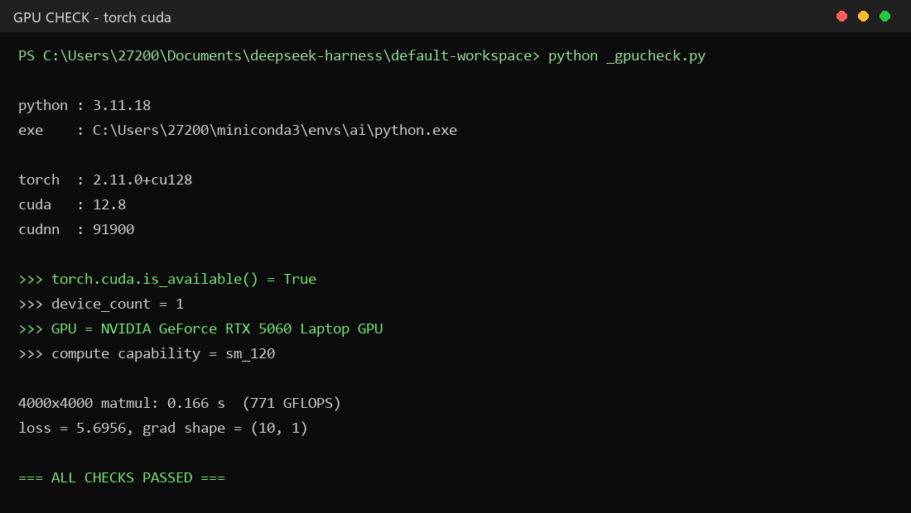

# ai-learning

我的 AI 学习记录。第 1 周：Python 基础、pandas 数据分析、数据可视化、Git、GPU 训练。

## 目录结构

```
ai-learning/
├── data/              原始数据
│   └── gdp.csv        332 个城市的经济数据（26 省，已注入缺失值用于练习）
├── scripts/           代码
│   ├── analyze.py     数据清洗 + 统计汇总
│   ├── plot.py        画 3 张图
│   └── train_linear.py GPU 线性回归训练
├── outputs/           运行产物
│   ├── province_stats.csv
│   ├── top10_city.csv
│   └── fig1~fig3.png
├── docs/              截图与说明图
├── report.md          数据分析报告（Day 4）
├── LOG.md             第 1 周每日日志
└── week1-review.md    第 1 周复盘
```

## 环境验证



```
torch 2.11.0+cu128 · CUDA 12.8 · NVIDIA GeForce RTX 5060 Laptop GPU · sm_120
```

## 怎么运行

1. 安装依赖：

   ```powershell
   pip install -r requirements.txt
   ```

2. 数据处理（产出 `outputs/province_stats.csv`、`outputs/top10_city.csv`）：

   ```powershell
   python scripts/analyze.py
   ```

3. 画图（产出 `outputs/fig1~fig3.png`）：

   ```powershell
   python scripts/plot.py
   ```

4. 训练线性回归（需要 GPU）：

   ```powershell
   python scripts/train_linear.py
   ```

> 三个脚本都用 `Path(__file__).parent.parent` 定位项目根目录，所以在哪个目录下执行都能跑通。

## 心得

- 装包永远用 `python -m pip install`，否则可能装进另一个 Python
- 报错先看它说的是哪个解释器、哪个路径，别急着重装
- 大部分缺失值不该填 —— 填了之后相关系数从 0.84 掉到 0.69，那不是补全，是把数据改坏
