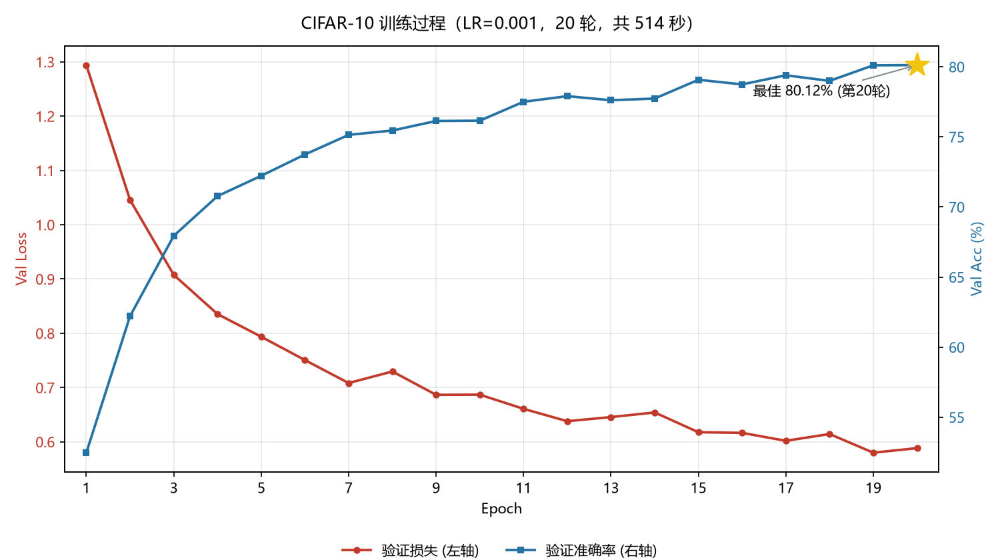

# CIFAR-10 图像分类

用 PyTorch 从零手写的 CIFAR-10 十分类项目：自己定义卷积网络、自己写训练循环、自己写推理脚本。没有用任何现成框架（除了 PyTorch 本身）。



**最终成绩：验证集准确率 80.12%，20 轮训练用时 8 分 34 秒（RTX 5060 Laptop）。**

---

## 一、项目简介

CIFAR-10 是 10 类彩色图片数据集（飞机、汽车、鸟、猫、鹿、狗、蛙、马、船、卡车），每张 32×32 像素，训练集 50000 张、测试集 10000 张。

本项目的模型是一个 3 层卷积 + 2 层全连接的 CNN，约 62 万参数：

```
输入 3×32×32
  → Conv(3→32)  + ReLU + MaxPool  →  32×16×16
  → Conv(32→64) + ReLU + MaxPool  →  64×8×8
  → Conv(64→128)+ ReLU + MaxPool  →  128×4×4
  → Flatten                        →  2048
  → Linear(2048→256) + ReLU + Dropout(0.5)
  → Linear(256→10)
```

训练时用了两种防过拟合手段：**数据增强**（随机裁剪 + 随机水平翻转）和 **Dropout(0.5)**。

---

## 二、环境说明

| 项目 | 版本 |
|---|---|
| Python | 3.11.18 |
| PyTorch | 2.11.0+cu128 |
| torchvision | 0.26.0+cu128 |
| CUDA | 12.8（cudnn 91900） |
| 显卡 | NVIDIA GeForce RTX 5060 Laptop GPU（sm_120，8 GB） |
| 操作系统 | Windows 11 |

### 安装依赖

```powershell
pip install -r requirements.txt
```

`requirements.txt` 里已经写了 `--extra-index-url https://download.pytorch.org/whl/cu128`，因为 `torch==2.11.0+cu128` 这种带本地版本号的包不在 PyPI 主源上。

**没有 NVIDIA 显卡？** 把 requirements.txt 里的 `torch` / `torchvision` 两行改成不带 `+cu128` 的版本，并删掉 `--extra-index-url` 那行，装 CPU 版即可运行（速度会慢很多，20 轮大概要一个多小时）。

---

## 三、目录说明

```
week_2/
├── requirements.txt        # 依赖清单（本文件）
├── README.md               # 本文件
├── week2-review.md         # 本周复盘
│
├── CIFAR-10/               # ← 本项目主体
│   ├── model.py            # 网络结构定义（CifarCNN + build_model）
│   ├── train.py            # 训练脚本：数据加载、训练循环、验证、早停、保存
│   ├── predict.py          # 推理脚本：加载 best.pt，对一张测试图预测
│   ├── data/               # 数据集缓存（首次运行自动下载，162 MB）
│   ├── best.pt             # 训练过程中验证准确率最高的一份权重
│   ├── train_run.log       # 训练日志（20 轮完整输出）
│   ├── ablation.log        # 对照实验日志（去掉增强和 Dropout）
│   └── 训练曲线.png         # 损失 / 准确率曲线
│
├── mnist/                  # 上一份练习：MNIST 手写数字（全连接网络，96.57%）
├── Dataset/               # 数据集加载练习：Dataset 子类 + DataLoader
├── linear/                # 线性回归拆文件练习：config/data/model/train/utils
└── 11.24/                 # 线性回归单文件版 + 损失曲线
```

真正要看的只有 `CIFAR-10/` 那一个文件夹，其余三个是这一周的练习，留着当参照。

---

## 四、如何运行

### 训练

```powershell
cd CIFAR-10
python train.py
```

首次运行会自动下载 CIFAR-10（162 MB）。**国内直连多伦多大学官方源只有 4 KB/s，建议挂代理**，否则要下十几个小时。

训练过程会打印每一轮的验证损失和准确率，验证准确率创新高时自动保存 `best.pt`，连续 3 轮不提升则早停。

### 推理

```powershell
cd CIFAR-10
python predict.py
```

输出示例：

```
真实标签: 3 (cat)
------------------------------
预测概率最高的前3个类别：
cat         : 76.42%
dog         : 18.31%
deer        : 2.15%
```

### 关键超参数（`train.py` 顶部）

```python
EPOCHS = 20
BATCH_SIZE = 64
LR = 0.001      # ⚠️ 不要改成 0.01，模型会完全学不动（见下方说明）
PATIENCE = 3
```

---

## 五、结果对比表

为了搞清楚「数据增强 + Dropout 到底有没有用」，做了两组对照实验。**除了这两个开关，其余完全一致**（同样的网络结构、同样的学习率、同样 20 轮）。

| 配置 | 训练集 Acc | 验证集 Acc | 最小验证损失 | 训练-验证差距 | 是否过拟合 |
|---|---|---|---|---|---|
| 裸跑（无增强、无 Dropout） | **97.88%** | 75.23%（最佳 76.60%） | 0.7228（第 6 轮） | **22.65 个百分点** | **严重** |
| 增强 + Dropout（本项目） | 83.36% | **80.12%** | 0.5800（第 19 轮） | 3.24 个百分点 | 较轻 |

### 怎么读这张表

**① 裸跑的验证准确率反而更低**

直觉上「不用增强、不用 Dropout」应该更自由、更强，实际是 75.23% 对 80.12%。原因见第二行。

**② 裸跑从第 7 轮就开始过拟合了**

看 `ablation.log` 的走势：

```
Epoch 06 | Train Acc: 84.85% | Val Loss: 0.7228 | Val Acc: 76.60%   ← 验证集最高点
Epoch 07 | Train Acc: 88.04% | Val Loss: 0.8029 | Val Acc: 75.40%   ← 验证损失开始回升
...
Epoch 20 | Train Acc: 97.88% | Val Loss: 1.8112 | Val Acc: 75.23%
```

训练准确率一路涨到 97.88%，验证损失却从 0.72 涨到 1.81（翻了 2.5 倍）。**这就是过拟合的标准长相：训练集背得越来越熟，新题做得越来越差。**

**③ 加了增强和 Dropout 之后，训练准确率反而「变低」了**

83.36% 比 97.88% 低不少，但这不是坏事——

- 训练时图片被随机裁剪、翻转，模型看到的是「变过形」的图，本来就难认
- Dropout 随机丢掉一半神经元，相当于每次都在残缺状态下做题

**训练变难了，泛化却变好了。** 这正是正则化的本质：主动降低训练时的拟合能力，换取对新数据的适应力。

**④ 差距 22.65 → 3.24，这才是核心指标**

光看准不准会误判，看「训练集和验证集差多少」才能判断模型是真的学会还是背答案。

---

## 六、踩过的坑（留给以后的自己）

### 坑 1：`LR = 0.01` 让模型彻底学不动

用 0.01 跑出来的结果是：

```
Epoch 01 | Val Loss: 2.3035 | Val Acc: 10.00%
Epoch 02 | Val Loss: 2.3035 | Val Acc: 10.00%
Epoch 03 | Val Loss: 2.3031 | Val Acc: 10.00%
连续 3 轮未提升，触发早停！
```

**`2.3035 = ln(10)`**，也就是 10 类完全随机猜的交叉熵。损失一动不动，准确率卡在 10%，说明模型根本没有在学习。

原因是 Adam 的标准学习率是 0.001，0.01 大了 10 倍，一步迈太远，ReLU 神经元全被推到负半轴死掉，输出恒为 0，梯度恒为 0，再也救不回来。

**判断口诀：loss 停在 `ln(类别数)` 不动 → 学习率太大，模型死了。**

### 坑 2：Windows 上 `nn.Conv2d(3.32, ...)` 少个逗号

`3, 32`（3 通道进、32 通道出）打成 `3.32`，变成一个浮点数，报 `TypeError: 'float' object cannot be interpreted as an integer`。在等宽字体下这两个写法几乎看不出区别。

### 坑 3：数据集下载卡住，误以为程序挂了

`data/` 十分钟只涨 5 MB，python 进程占 579 MB 内存但 CPU 只用 2.8 秒、GPU 占用 0%。

**这三个数字合起来说明它没在算，它在等网络。** 遇到「跑得很慢」先用任务管理器和 nvidia-smi 看一眼，别傻等。

---

## 七、已知局限 & 下一步

这个 80.12% 达到了该结构（3 层卷积、无 BatchNorm、无残差）的合理水平，但还有明显的提升空间：

| 改进方向 | 预计提升 | 成本 |
|---|---|---|
| 加 `BatchNorm2d` | +3~5% | 每层加一行，训练稍慢 |
| 学习率衰减（CosineAnnealingLR） | +1~2% | 几行代码 |
| 训练更长（40~60 轮） | +1~2% | 时间翻倍 |
| 加深网络 / 加残差连接 | +2~3% | 需要重写结构 |
| 更多增强（RandomErasing、ColorJitter） | +1% | 一行 transform |

当前模型第 20 轮验证准确率还在微涨（19→20 轮涨 0.02%），说明**还没完全收敛**，单纯加轮数大约能到 82%。

---

## 八、数据来源

CIFAR-10 由 Alex Krizhevsky、Vinod Nair、Geoffrey Hinton 整理，官方地址：
https://www.cs.toronto.edu/~kriz/cifar-10-python.html

仅用于学习目的。
